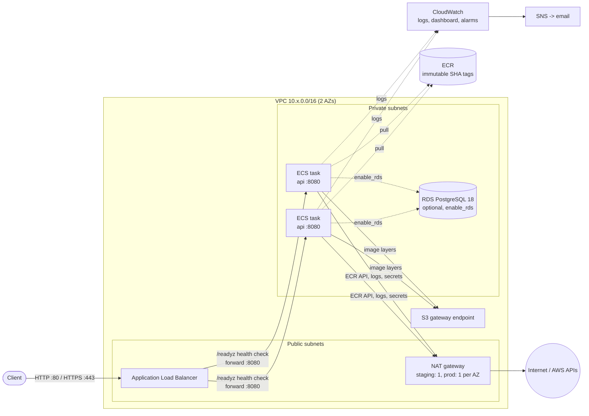
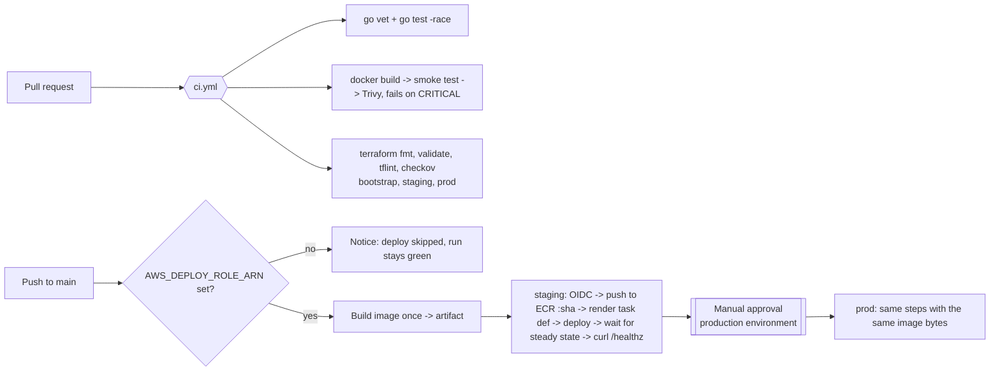

# Deploying orderflow on AWS (ECS Fargate)

Terraform builds two environments, `staging` and `prod`, from the same modules.
GitHub Actions deploys every push to `main` to staging, then to prod after a
manual approval. Authentication is OIDC only: there are no AWS access keys
anywhere. `make down` removes an environment completely.

- [Architecture](#architecture)
- [CI/CD flow](#cicd-flow)
- [Cost per day](#cost-per-day)
- [First-time setup](#first-time-setup)
- [Day-to-day](#day-to-day)
- [Teardown](#teardown)
- [Troubleshooting](#troubleshooting)
- [Security scan exceptions](#security-scan-exceptions)

## Architecture



**Request flow.** A client hits the ALB in the public subnets. The ALB
forwards to a healthy task in a private subnet on port 8080. Tasks have no
public IP, and their security group accepts traffic only from the ALB's
security group. The target group health check calls `GET /readyz` every
15s. A task that fails it three times is taken out of rotation, and ECS
replaces it.

Per environment, Terraform creates:

| Module | What it creates |
|---|---|
| `kms` | One customer-managed key for this env's logs, SNS, ECR and RDS |
| `network` | VPC, 2 public and 2 private subnets, NAT (`none`/`single`/`per_az`), optional interface endpoints, free S3 gateway endpoint, flow logs for rejected traffic |
| `ecr` | Repository: immutable tags, scan on push, keeps the last 20 images, `force_delete` |
| `ecs-service` | Cluster (Container Insights), task definition, service, ALB, target group, autoscaling on CPU and ALB requests per task, circuit breaker with rollback |
| `observability` | Log group (14 days), SNS topic and email, alarms (5xx, p95 latency, CPU, running tasks), dashboard |
| `github-oidc` | Deploy role trusted only by this repo's matching GitHub Environment |
| `budget` | Monthly AWS Budgets limit, alerts at 80% and 100% actual and 100% forecast |
| `rds` (off) | PostgreSQL 18, private, encrypted, password managed by RDS in Secrets Manager and injected as `DB_PASSWORD` |

`bootstrap/` is applied once per AWS account. It creates the encrypted,
versioned S3 state bucket (locking uses S3 lock files, `use_lockfile`) and
the GitHub OIDC identity provider. IAM allows only one OIDC provider per
URL per account, so it can't live in the per-env stacks.

| | staging | prod |
|---|---|---|
| Tasks | 1 (autoscale to 2) | 2 across 2 AZs (autoscale to 6) |
| Capacity | Fargate Spot | Fargate on-demand |
| NAT | 1 shared | 1 per AZ |
| RDS when enabled | single-AZ | Multi-AZ |
| Deploys | every push to `main` | after approval in the `production` GitHub Environment |

Every resource is tagged `Project`, `Env`, `Owner` and `ManagedBy=terraform`
through the provider's `default_tags`.

## CI/CD flow



- CI never touches AWS. Terraform runs `init -backend=false` with no
  credentials.
- The image is built once. Each environment pushes the same tarball to its
  own ECR repository, so prod runs exactly what staging tested.
- The deploy role's trust policy pins the OIDC `sub` claim to
  `repo:minhhieu21193/orderflow:environment:<env>`. Only a job running in
  that GitHub Environment can assume it, and the production environment
  can require reviewers before that job starts.
- All actions are pinned to commit SHAs, and tool versions are pinned in
  the workflow `env` blocks.

**Who owns what.** Terraform owns the infrastructure and the task
definition's shape: CPU, memory, environment variables and secrets. CI owns
image rollouts: it registers new revisions of the same family with a new
image. `make up` always deploys the image for the current `HEAD`. Running it
after CI has deployed `HEAD` just rolls the same image out again under
Terraform's revision.

## Cost per day

These are ap-southeast-1 on-demand prices from the public AWS Price List
API, retrieved 2026-10-26. They change, so check the
[AWS Pricing Calculator](https://calculator.aws/) before relying on them.

| Item | Unit price | staging / day | prod / day |
|---|---|---|---|
| Fargate x86, 0.25 vCPU + 0.5 GB per task | $0.05056 per vCPU-h, $0.00553 per GB-h | 1 Spot task: **$0.11** (about 70% off) | 2 tasks: **$0.74** |
| Application Load Balancer | $0.0252/h + $0.008 per LCU-h | **$0.62** | **$0.62** |
| NAT gateway | $0.059/h + $0.059/GB | 1 NAT, ~1 GB: **$1.48** | 2 NATs, ~2 GB: **$2.95** |
| Public IPv4 addresses | $0.005/h each | ALB ×2 + NAT ×1: **$0.36** | ALB ×2 + NAT ×2: **$0.48** |
| KMS key | $1/month | **$0.03** | **$0.03** |
| CloudWatch: Container Insights (~30 metrics at $0.30/metric-month), logs (<100 MB/day at $0.70/GB), dashboard ($3/month after the first 3 free), 4 alarms (first 10 free) | | **~$0.45** | **~$0.45** |
| **Total** | | **≈ $3.05/day** (~$93/month) | **≈ $5.27/day** (~$160/month) |
| Optional RDS db.t4g.micro + 20 GB gp3 | $0.025/h single-AZ, $0.051/h Multi-AZ; $0.138 or $0.276 per GB-month | +$0.69 | +$1.41 (Multi-AZ) |

Assumptions:
- Demo traffic means the ALB uses about 0.1 LCU, and NAT data is mostly
  ECR API calls and logs. Image layers come through the free S3 gateway
  endpoint.
- The Spot price is a point-in-time snapshot of a variable price.
- Data transfer out to the internet, AWS Budgets and anything left running
  after `make down` are not included.
- NAT is the biggest line item. If staging must be cheaper still,
  `nat_gateway_mode = "none"` with `enable_interface_endpoints = true`
  costs 4 endpoints × 2 AZs × $0.013/h ≈ $2.50/day. That is more than one
  NAT, so a single NAT stays the default.
- **A typical portfolio session** (both envs up for 4 hours, then
  `make down`) costs about **$1.40**.

The budgets ($30/month for staging, $100/month for prod) are tripwires for a
stack that was left running, not forecasts. Both are account-wide by
default, because cost allocation tags take about 24h to activate, so the
forecast alert fires within days if anything keeps billing. Once the `Env`
tag is activated in Billing, set `cost_filter_tag` in the `budget` module to
scope each budget to its env.

## First-time setup

Prerequisites: an AWS account and admin credentials for it in your shell
(`aws sts get-caller-identity` works), Terraform 1.17.x, Docker with
buildx, and `make`. Region defaults to `ap-southeast-1`; pass `REGION=...`
to any make target to change it.

1. **Bootstrap the account** (once): creates the state bucket and the OIDC provider.
   ```bash
   cp deploy/terraform/bootstrap/terraform.tfvars.example deploy/terraform/bootstrap/terraform.tfvars   # set owner
   make tf-bootstrap
   ```
   Bootstrap keeps its own state locally in
   `deploy/terraform/bootstrap/terraform.tfstate` (gitignored). Back it up,
   or move it into the new bucket by adding a `backend "s3"` block and
   running `terraform init -migrate-state`.

2. **Create staging**. This applies the ECR repo, pushes the image for `HEAD`, then applies the rest:
   ```bash
   cp deploy/terraform/envs/staging/terraform.tfvars.example deploy/terraform/envs/staging/terraform.tfvars   # owner, alert_email
   make up ENV=staging
   curl "$(terraform -chdir=deploy/terraform/envs/staging output -raw url)/healthz"
   ```
   Confirm the SNS subscription email so alarms reach you.

3. **Create prod** the same way with `ENV=prod`.

4. **Connect GitHub** (Settings → Secrets and variables / Environments):
   - Repository variable `AWS_DEPLOY_ROLE_ARN` = `terraform -chdir=deploy/terraform/envs/staging output -raw github_deploy_role_arn`
   - Optional repository variable `AWS_REGION` if you are not using `ap-southeast-1`
   - Environment `staging`: no extra settings needed. The repository variable applies.
   - Environment `production`: add **required reviewers**, and an
     environment variable `AWS_DEPLOY_ROLE_ARN` = the prod output of
     `github_deploy_role_arn`. It overrides the repository value inside
     prod jobs. Without it, prod jobs try the staging role and are denied,
     which is safe but fails.

5. **Push to `main`**. The `deploy` workflow builds, deploys to staging,
   smoke-tests it, and waits for your approval before prod.

## Day-to-day

| Command | What it does |
|---|---|
| `make check` | Every CI check locally (go, docker, image size, container smoke test, hadolint, actionlint, terraform fmt/validate, tflint, checkov). Needs no AWS access. |
| `make plan ENV=prod` | Plans with `image_tag` = current `HEAD` |
| `make up ENV=staging` | Creates or updates the env and deploys `HEAD` |
| `make down ENV=staging` | Destroys the env |

Turn on the database with `enable_rds = true` in the env's `terraform.tfvars`.
The task then receives `DB_HOST`, `DB_PORT`, `DB_NAME`, `DB_USER` and
`DB_PASSWORD`, the last injected from Secrets Manager. For HTTPS, set
`certificate_arn` to an ACM certificate in the same region and point a DNS
record at the ALB.

## Teardown

```bash
make down ENV=prod
make down ENV=staging
```

`down` destroys everything in the env: the ECR repository with its images
(`force_delete`), the log groups including Container Insights, the NAT
gateways, the ALB and RDS (no final snapshot unless `deletion_protection` is
on). KMS keys enter their 7-day deletion window. Afterwards, delete the
`AWS_DEPLOY_ROLE_ARN` repository variable so pushes to `main` skip the
deploy cleanly.

The bootstrap bucket and OIDC provider stay. They cost cents a month: S3
storage plus $1/month for the state bucket's KMS key. To remove them too,
empty the bucket (all versions), delete the `prevent_destroy` lifecycle
block, and run `terraform -chdir=deploy/terraform/bootstrap destroy`.

## Troubleshooting

**Tasks fail the health check and keep restarting**
- See why the ALB marks them unhealthy:
  `aws elbv2 describe-target-health --target-group-arn <tg-arn>`.
  `Target.Timeout` usually means a security group or port problem.
  `Target.ResponseCodeMismatch` means `/readyz` isn't returning 200.
- Read the app logs in CloudWatch log group `/ecs/orderflow-<env>`. A crash
  on start, such as an invalid `PORT`, shows there.
- The container must listen on the port the task definition passes as
  `PORT` (8080).
- If new tasks keep failing to become healthy, the deployment circuit
  breaker stops the rollout and rolls back to the last working revision.
  The service events say so.

**Image pull errors (`CannotPullContainerError`)**
- `not found`: the tag isn't in ECR. CI pushes before it deploys, and
  `make up` pushes `HEAD`. Check with
  `aws ecr describe-images --repository-name orderflow-<env>`.
- `i/o timeout` or `context deadline exceeded`: tasks can't reach ECR. With
  `nat_gateway_mode = "none"`, `enable_interface_endpoints` must be true;
  Terraform refuses the combination otherwise.
- `exec format error` in the logs: the image architecture doesn't match the
  task (X86_64). Build with `--platform linux/amd64`, as
  `scripts/push-image.sh` and CI do.

**Deployment stuck or the deploy job times out**
- `aws ecs describe-services --cluster orderflow-<env> --services orderflow-<env> --query 'services[0].events[:10]'`
  shows what ECS is waiting on.
- Staging on Fargate Spot can wait for Spot capacity. Switch
  `capacity_provider` to `FARGATE` in `envs/staging/main.tf` if it
  persists.
- `Not authorized to perform sts:AssumeRoleWithWebIdentity`: the job's
  GitHub Environment doesn't match the role's trust. The production
  environment needs its own `AWS_DEPLOY_ROLE_ARN` (see setup step 4).
- After CI deploys, `make plan` shows the service moving back to
  Terraform's task definition revision. That's expected, see "Who owns
  what". Applying it deploys `HEAD`.

## Security scan exceptions

checkov runs on every root, and each skipped rule sits next to its resource
as `#checkov:skip=<ID>:<reason>`. Every skip below was confirmed to match a
check that fails without it.

| Rule | Resource | Reason |
|---|---|---|
| CKV_AWS_18, CKV_AWS_144, CKV2_AWS_62 | bootstrap state bucket | No access-log bucket, cross-region replication or event consumers for a single-region demo; versioning and KMS protect the state |
| CKV_AWS_109, CKV_AWS_111, CKV_AWS_356 | KMS key policies | Standard account-root key policy; `*` in a key policy means "this key" |
| CKV_AWS_338 | app, flow-log and Container Insights log groups | 14-day retention is a deliberate cost choice (the rule wants 1 year) |
| CKV_AWS_91 | ALB | Access logs need an extra bucket; request logs are in the app log group |
| CKV_AWS_150 | ALB | Deletion protection off so `make down` works; `enable_deletion_protection` turns it on |
| CKV2_AWS_28 | ALB | No WAF (~$5+/month) for a demo |
| CKV_AWS_2 | HTTP listener | No domain in the demo; with `certificate_arn` it redirects to HTTPS |
| CKV_AWS_378 | target group | TLS ends at the ALB; ALB-to-task traffic stays in private subnets |
| CKV_AWS_118, CKV_AWS_293, CKV_AWS_353 | RDS (only if enabled) | No enhanced monitoring; deletion protection is a variable; Performance Insights isn't offered on the micro class |
